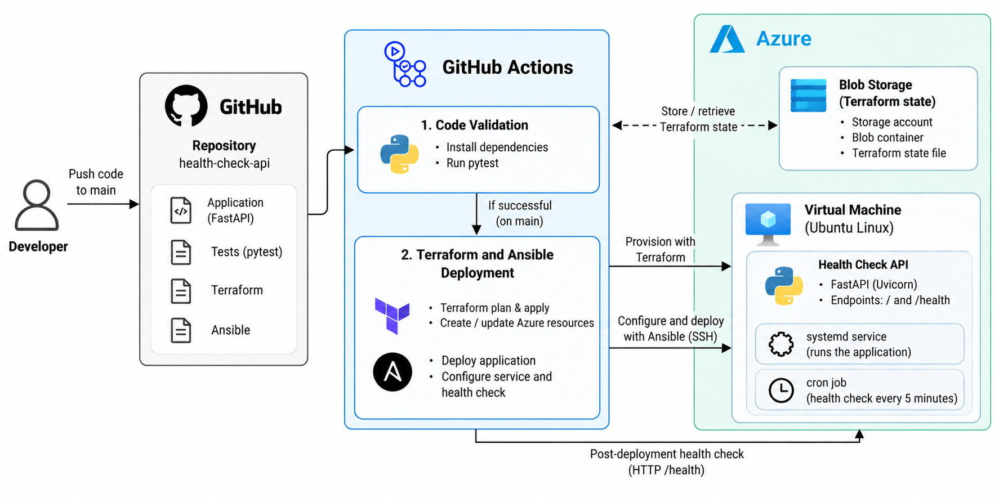

# Health Check API

A small FastAPI service deployed on an Azure Linux VM using Terraform, Ansible, and GitHub Actions. This project demonstrates infrastructure provisioning, automated deployment, service recovery, and post-deployment health verification.

## Live Demo

- [API Endpoint](http://20.198.86.220:8000/)
- [Health Check](http://20.198.86.220:8000/health)

## GitHub Actions

- [Code Validation Workflow](https://github.com/rjn991/health-check-api/actions/workflows/code-validate.yaml)
- [Terraform & Ansible Deployment Workflow](https://github.com/rjn991/health-check-api/actions/workflows/deploy.yaml)

## Successful Workflow Execution Output

- [Code Validation](https://github.com/rjn991/health-check-api/actions/runs/40163469403/job/121079650140) — runs automated tests.
- [Terraform & Ansible Deployment](https://github.com/rjn991/health-check-api/actions/runs/40163496808/job/121079729732) — provisions infrastructure, deploys the application, and verifies the health endpoint.

Open the workflow runs to review execution logs, test results, and deployment verification.

## Documentation

- [Architecture Diagram](docs/architecture.png)
- [Operations Guide](docs/operations.md)

## Features

- `GET /` returns a service message.
- `GET /health` returns the service status and a UTC timestamp.
- Terraform provisions and manages Azure infrastructure.
- Azure Blob Storage stores Terraform state.
- Ansible deploys and configures the application on the VM.
- systemd starts the API at boot and restarts it if the process exits.
- A cron job checks API health every five minutes and attempts a restart if unhealthy.
- GitHub Actions validates the code and verifies the deployed API.

## Architecture



A client sends requests to the FastAPI application running on the Azure VM. GitHub Actions validates code changes, Terraform provisions infrastructure, and Ansible deploys and configures the application. The deployment workflow then checks the `/health` endpoint. Terraform state is stored in Azure Blob Storage.

## Technology Stack

- **Application:** Python, FastAPI, Uvicorn
- **Cloud:** Azure Linux VM, networking and Network Security Group
- **State Management:** Azure Blob Storage
- **Infrastructure as Code:** Terraform
- **Configuration Management:** Ansible
- **CI/CD:** GitHub Actions
- **Service Management:** systemd and cron

## Repository Structure

```text
health-check-api/
├── app/
│   └── main.py
├── tests/
│   └── test_main.py
├── terraform/
│   └── Terraform configuration
├── ansible/
│   ├── playbook.yaml
│   └── templates/
│       ├── health-check-api.service.j2
│       └── health-check.sh.j2
├── .github/
│   └── workflows/
│       ├── code-validate.yaml
│       └── deploy.yaml
├── docs/
│   ├── architecture.png
│   └── operations.md
├── requirements.txt
└── README.md
```

## Prerequisites

- Python 3.12 or compatible
- Git
- An Azure subscription with permissions to manage the required resources
- Terraform and Azure CLI if running infrastructure commands locally
- An SSH key pair for VM access and Ansible

## Run Locally

Create and activate a virtual environment.

Linux/macOS:

```bash
python3 -m venv .venv
source .venv/bin/activate
```

Windows PowerShell:

```powershell
python -m venv .venv
.\.venv\Scripts\Activate.ps1
```

Install dependencies:

```bash
pip install -r requirements.txt
```

Start the API:

```bash
uvicorn app.main:app --host 127.0.0.1 --port 8000
```

Test the endpoints in another terminal:

```bash
curl http://127.0.0.1:8000/
curl http://127.0.0.1:8000/health
```

## Run Tests

Install the test dependencies if they are not already included:

```bash
pip install pytest httpx
```

Run the tests from the repository root:

```bash
PYTHONPATH=. pytest -v
```

The tests verify the root endpoint response and confirm that `/health` returns HTTP 200 with a healthy status and timestamp.

## CI/CD Workflows

### Code Validation

The Code Validation workflow installs the required Python dependencies and runs pytest against the application endpoints.

### Terraform and Ansible Deployment

After Code Validation succeeds on `main`, the deployment workflow:

1. Generates Terraform variables from GitHub configuration.
2. Configures SSH access for the administrator and GitHub Actions runner.
3. Runs Terraform formatting, initialization, validation, planning, and apply.
4. Configures SSH and generates the Ansible inventory.
5. Waits for VM connectivity and deploys the application using Ansible.
6. Requests `/health` and fails the workflow if the API does not become healthy within the retry window.

The deployment workflow can also be started manually from GitHub Actions.

## GitHub Configuration

Configure the following repository secrets:

- `AZURE_CLIENT_ID`
- `AZURE_CLIENT_SECRET`
- `AZURE_TENANT_ID`
- `AZURE_SUBSCRIPTION_ID`
- `AZURE_SSH_PRIVATE_KEY`

Configure the following repository variables:

- `TF_LOCATION`
- `TF_RESOURCE_GROUP_NAME`
- `TF_VM_NAME`
- `TF_VM_SIZE`
- `TF_ADMIN_USERNAME`
- `AZURE_SSH_PUBLIC_KEY`
- `ADMIN_SSH_CIDR`

Never commit secrets or private keys to the repository.

## Network Access

- **Port 8000 (HTTP):** Allows inbound traffic from any source IP (`*`) for public API access.
- **Port 22 (SSH):** Restricted to the configured administrator CIDR and GitHub Actions runner IP.

The deployment workflow verifies the API through the `/health` endpoint on port 8000.

## Cleanup

1. Review the Terraform destroy plan.
2. Destroy the application infrastructure using the same Terraform configuration and state.
3. Remove Terraform state storage only if it is dedicated to this project and no longer needed.

## Troubleshooting

- **Tests fail:** Run `PYTHONPATH=. pytest -v` and inspect the failed assertion.
- **Terraform fails:** Check Azure credentials, permissions, variables, and backend state access.
- **SSH fails:** Check the VM IP, username, SSH key, administrator CIDR, runner IP, and Network Security Group.
- **Ansible fails:** Inspect the failed task in the GitHub Actions logs.
- **Health check fails:** Check the systemd service, application logs, port 8000, network rules, and `/health` response.

See the [Operations Guide](docs/operations.md) for service logs, recovery commands, and outage response.
